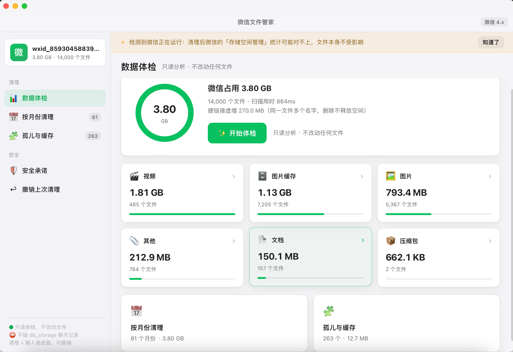
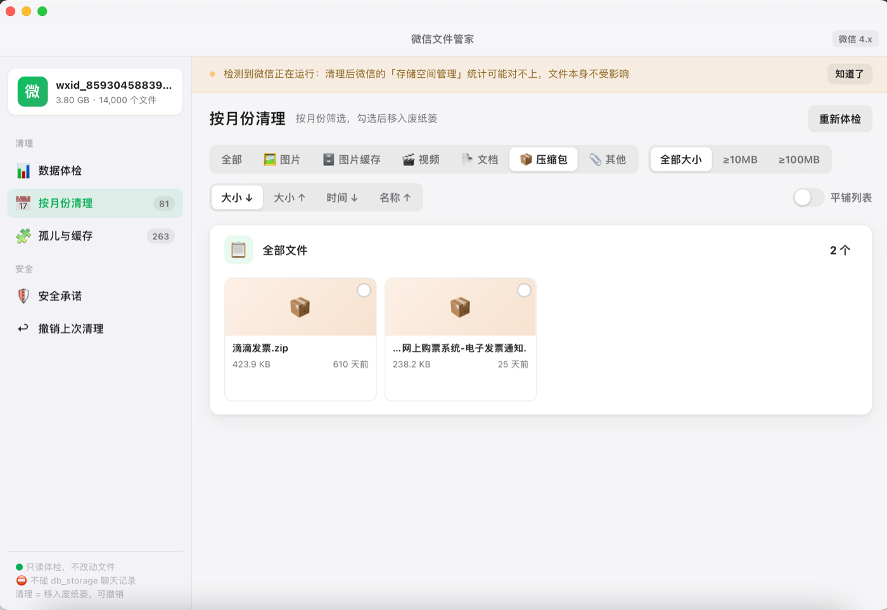
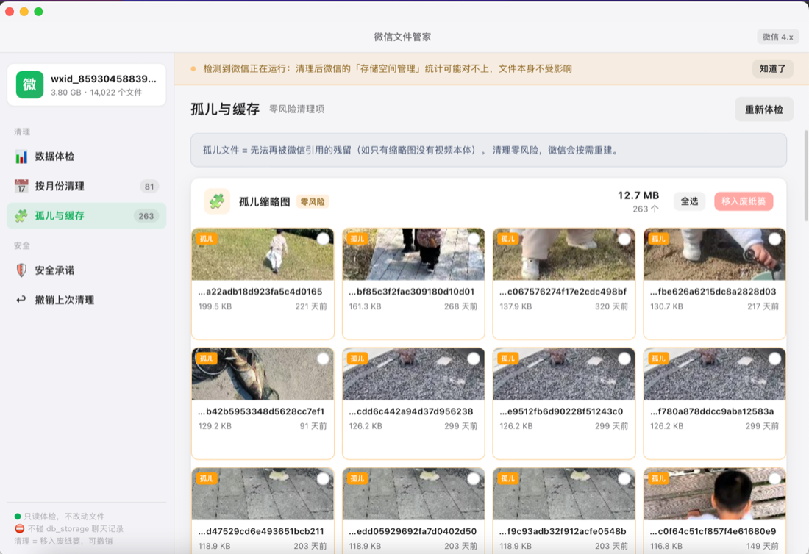

# 微信文件管家 WeClean

[](https://github.com/kennethfan/wechat-file-keeper/actions/workflows/ci.yml)
[](https://github.com/kennethfan/wechat-file-keeper/actions/workflows/release.yml)

macOS 微信本地文件清理工具：只读扫描微信留下的聊天文件、视频与图片缓存，按空间占用呈现，用户确认后把选中项通过 Finder 移入系统废纸篓。

界面用 **Wails v3 + WebView** 实现，视觉对齐 macOS 原生风（微信绿主色、毛玻璃、卡片与月份桶）。

## 为什么需要它

微信自己的「存储空间管理」只给一个总数，不能按大小排序、不能按月看，也不告诉你哪些是重复的。在 Finder 里手动翻容器目录更麻烦——而且 Finder 会把硬链接的同一份文件算成多个文件，让人误以为有几倍空间可以回收。

本机实测（微信 4.1.15，账号库 3.80 GB / 14001 个文件）：

| 范围 | 实占 | 说明 |
|---|---|---|
| `msg/attach` | 2.0 GB | 13310 个 `.dat`，其中约 7400 个是微信私有编码 |
| `msg/video` | 1.7 GB | 122 个 mp4 + 351 个封面图，单个最大 374 MB |
| `msg/file` | 140 MB | 169 个文件，保留原始文件名 |
| 硬链接虚增 | 270 MB | 同一 inode 挂了多个名字，删除**不释放空间** |
| 真重复 | 8.8 MB | 不同 inode 但内容一致，219 组 |

## 分类

六个分类，按真实格式而非目录归类：

| 分类 | 内容 | 能否预览 |
|---|---|---|
| 🖼 图片 | 标准 JPEG/PNG/GIF/TIFF（含视频封面） | ✅ |
| 🗄 图片缓存 | 微信私有编码的 `.dat`（文件头 `07 08 56 32`） | ❌ |
| 🎬 视频 | mp4 / mov / m4v | ✅ 显示封面 |
| 📄 文档 | pdf / docx / xlsx / txt / md 等 | 仅图标 |
| 📦 压缩包 | zip / rar / 7z 等 | 仅图标 |
| 📎 其他 | 其余文件 | 仅图标 |

`.dat` 需要读文件头才能区分：微信把聊天图片存成 `.dat`，但内容并未加密——一部分是标准图片，一部分是私有编码。只读前 4 字节，12792 个文件并发读完约 0.5 秒。

## 界面

启动即自动体检，四个视图。

### 数据体检



环形图显示总占用，下方六个分类卡片各带占用条。点击任意卡片直接跳到该分类的清理页。左侧栏顶部显示账号库标识与文件数，底部常驻三条安全承诺。

### 按月份清理



两层工具栏：类型筛选（全部/图片/图片缓存/视频/文档/压缩包/其他）、大小门槛、四种排序（大小↓↑、时间↓、名称↑）。

条目按月份聚合成桶，展开才加载内容——一万四千条全量渲染会让界面卡死。每个桶头有「全选」和「清理」，底部另有毛玻璃汇总栏。

### 孤儿与缓存



孤儿缩略图对应的视频已不存在，微信不会再读它，删了会按需重建，是唯一「零风险」的清理项。卡片左上角标「孤儿」，可一键全选后清理。

### 其他

- 条目支持三种视图模式（列表 / 表格 / 网格），按分类记忆选择
- 每张卡片悬停时显示「打开」「定位」两个按钮。打开 `.dat` 时会先按文件头改成正确扩展名再交给系统，因为系统不认识 `.dat`
- 选中条目右侧显示预览：图片直接解码、视频显示封面、其余显示文件图标

## 设计边界

- **不碰加密数据库**：谁发的文件、什么时候发的，都存在 `db_storage` 的加密 SQLite 里。本工具不读取、不解密，因此不提供会话归属（见 [ADR-0002](docs/adr/0002-no-conversation-attribution.md)）
- **空间以 inode 为准**：实占按 inode 归并，名义大小仅作对照，避免把硬链接误报成可回收空间（见 [ADR-0001](docs/adr/0001-inode-based-space-accounting.md)）
- **通过 Finder 移入废纸篓**：与你在 Finder 里手动删除完全一致，废纸篓里有「放回原处」。首次会请求「自动化」授权（见 [ADR-0005](docs/adr/0005-finder-only-trash.md)）
- **不建索引**：每次全量扫描，结果永远与当下磁盘一致（见 [ADR-0004](docs/adr/0004-no-persistent-index.md)）
- **微信运行时的风险分级**：孤儿缩略图直接可清；图片缓存与聊天文件会二次确认并说明后果，但**不阻止**——废纸篓本身是安全网

## 孤儿缩略图怎么判定

微信把视频和封面放在同一月份目录，文件名同基名：

```
视频   msg/video/2026-10/abc.mp4      或  abc_raw.mp4
封面   msg/video/2026-10/abc_thumb.jpg 或  abc.jpg
```

判定逻辑：先收集所有视频的「目录 + 基名」集合（`_raw` 会剥掉），再检查每个封面——同目录下找不到对应视频的即为孤儿。

两种封面命名都支持：老版 `<基名>_thumb.jpg`、新版 `<基名>.jpg`。只匹配同目录，跨目录同名不算。

孤儿缩略图对应的视频已不存在，微信不会再读它，删了会按需重建，是唯一「零风险」的清理项。

## 安装与使用

```bash
make app
open dist/微信文件管家.app
```

首次清理会弹出「想要控制 Finder」的授权框，选「好」。若误点拒绝，到「系统设置 → 隐私与安全性 → 自动化」里重新打开。

## 命令行

图形界面是主入口，CLI 保留给脚本与调试，两者共用同一套实现。

```bash
wechat-file-keeper scan                                    # 空间统计
wechat-file-keeper list --category 视频 --min-size 100MB    # 按分类与大小筛选
wechat-file-keeper dup                                     # 真重复分组（只读）
wechat-file-keeper cache                                   # 图片缓存年份分布
wechat-file-keeper clean --orphans                         # 预览清理计划
wechat-file-keeper clean --orphans --yes                   # 确认执行
wechat-file-keeper undo                                    # 回滚最近一次清理
```

`clean` 默认只打印计划，必须加 `--yes` 才动文件。微信图片（`/attach/` 下的）需额外加 `--include-cache`：它是本地唯一副本，微信服务器有过期策略，老缓存删了可能再也下载不回来。

`scan` 输出三个数字，缺一不可：

```
实占大小  3.80 GB
名义大小  4.07 GB
硬链接虚增 270.0 MB  （同一 inode 挂了多个名字，删除不释放空间）
```

## 开发

```bash
make check    # gofmt + vet + test
make build    # 编译到 bin/wechat-file-keeper
make app      # 打包 dist/微信文件管家.app
make icon     # 重新生成图标（需 Pillow）
```

### 架构

```
main.go               Wails 入口（无子命令时开窗口，有则转 CLI）
frontend/dist/        前端（原生 HTML/CSS/JS，无构建步骤，被 embed 进二进制）
internal/
  apiserver/          自建 HTTP JSON API（/api/*）
  bridge/             领域对象 ↔ 前端 DTO，缩略图编码
  cli/                命令行入口
  scan/ classify/ dup/ orphan/ cachestat/   扫描与分析
  clean/ guard/ trash/ undo/                清理与撤销
  preview/ thumb/ opener/                   预览与打开
  account/ model/ format/ view/             基础设施
```

**前后端不用 Wails 的绑定机制**。生成的绑定依赖 `/wails/runtime.js` 这个 ES module，实测在本机 WebKit（macOS 12.7）上静默加载失败，导致所有后端调用「点了没反应」。改用 `internal/apiserver` 提供普通 HTTP JSON 接口，前端只用 `fetch`，行为可预期。

### 三条硬约束

1. **改前端必须重新编译二进制** —— 前端被 `go:embed` 进二进制，只重启进程不生效
2. **改 `Info.plist` 必须重新 `make app`** —— 权限说明只在 `.app` 里生效，直接跑二进制不会带
3. **不要改回 rename 删除** —— macOS 只对 Finder 移入的项目记录原路径，rename 出来的废纸篓项没有「放回原处」也难辨认，等于自造废纸篓

### 性能约束

体检接口**不返回全量条目**（1.4 万条约 7.6 MB，浏览器解析会卡死几秒），改为 `/api/entries` 分页（每页 60 条约 30 KB）。月份桶只画桶头，展开时才拉条目。

缩略图必须**先缩放再编码**：微信封面可达 1080×1920，直接编码单张 657 KB；缩到最长边 336px 并用 JPEG(q82) 后降到 17 KB，降幅 96%。PNG 对照片类图像压缩率极差，不要改回去。

## 打包与签名

```bash
make app      # ad-hoc 签名，只够本机运行
make app SIGN_IDENTITY="Developer ID Application: Your Name (TEAMID)"   # 正式签名
```

图标按 Apple HIG 绘制：1024 画布上圆角方块主体 824×824 居中，四边各留 100px 透明边距。源图由 `packaging/make_icon_source.py` 生成，再经 `packaging/make_icon.py` 打包成 `.icns`。

## 发版

推送 `v*` tag 会自动触发 Release workflow，在 macOS runner 上打包、校验并发布：

```bash
git tag v0.1.1
git push origin v0.1.1
```

产物：`wechat-file-keeper-0.1.1.zip`（内含 `.app`）与 `checksums.txt`。
workflow 会校验 `codesign`、`NSAppleEventsUsageDescription` 与版本号，缺任何一项都会失败——避免发出版本号不对或缺权限说明的包。

版本号由 tag 决定（`v0.1.1` → `0.1.1`），写入 `Info.plist` 的 `CFBundleShortVersionString` 与 `CFBundleVersion`。

## 开发文档

- [CONTEXT.md](CONTEXT.md) — 领域词汇表
- [docs/adr/](docs/adr/) — 5 份架构决策记录
- [AGENTS.md](AGENTS.md) — 工程技能配置与架构要点

## 许可

MIT
